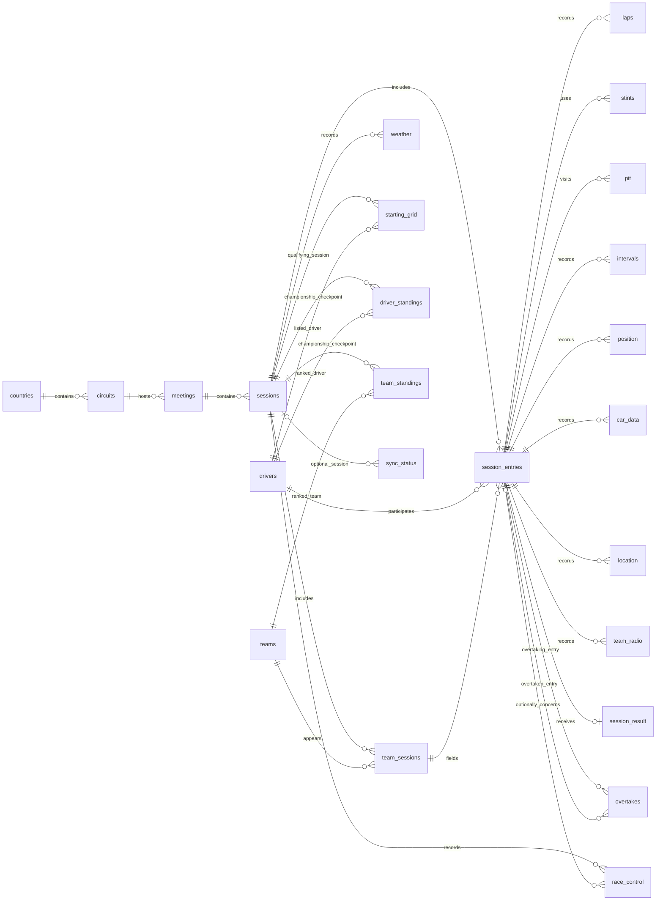

# Approved normalized OpenF1 model

Approved on 2026-10-11 and implemented with dbt Fusion 2.0.8. This replaces the earlier proposal for a wide `race_laps` table. The model keeps one concept and grain per table, normalizes driver/team identities and geography, and preserves the original observation timelines.

The analytical destination is **`__F1_GCP_PROJECT__.f1`**. The 19 `f1_openf1` and seven `f1_documents` source tables remain ingestion-owned and unchanged. dbt materializes 26 model tables, including two computed identity lookups. There are no seeds, views, generic payloads, embeddings or inferred Qualifying entries.

## Relationships

Crow's feet indicate the many side. Lines are logical, tested relationships; BigQuery foreign-key constraints are not declared. Every entry relationship uses **both `session_key` and `driver_number`**, including both driver roles in overtakes. Redundant direct session relationships are omitted for clarity.



## Table grains

| Table | Key | Contents |
|---|---|---|
| `countries` | `country_key` | Venue country code, name and flag |
| `circuits` | `circuit_key` | Country reference, circuit name/type, location, image and info URL |
| `meetings` | `meeting_key` | Circuit reference, event names, year, dates, offset and cancellation status; includes testing |
| `sessions` | `session_key` | Meeting reference, session name/type, dates, offset and cancellation status |
| `drivers` | `driver_id` | Canonical person and source name/profile fields; no number or team membership |
| `teams` | `team_id` | Canonical team name |
| `team_sessions` | `session_key, team_id` | Team colour as observed in that session |
| `session_entries` | `session_key, driver_number` | References to person and team; one original Race entry |
| `laps` | `session_key, driver_number, lap_number` | Lap/sector timing, speed measurements, pit-out indicator, sector segment arrays |
| `stints` | `session_key, driver_number, stint_number` | Tyre compound, lap bounds, tyre age at start |
| `pit` | `session_key, driver_number, date` | Pit-lane event, source lap, lane/pit/stationary durations |
| `intervals` | `session_key, driver_number, date` | Gap to leader and interval; numeric and lap labels remain strings |
| `position` | `session_key, driver_number, date` | Running order |
| `car_data` | `session_key, driver_number, date` | Speed, throttle, brake, gear, RPM and DRS |
| `location` | `session_key, driver_number, date` | Source x/y/z coordinates |
| `team_radio` | `session_key, driver_number, date, recording_url` | Recording URL; audio is not transcribed |
| `session_result` | `session_key, driver_number` | Race finish position, points, duration, laps, gap and DNS/DNF/DSQ |
| `overtakes` | `session_key, date, overtaking_driver_number, overtaken_driver_number` | Position exchange and resulting position |
| `weather` | `session_key, date` | Air/track temperature, humidity, pressure, rain and wind |
| `race_control` | `session_key, message_id` | Message text, category, scope, timestamp, optional driver/lap/flag/sector |
| `starting_grid` | `session_key, driver_id` | Main Qualifying grid position and lap duration |
| `driver_standings` | `session_key, driver_id` | Championship points and position before/after the Race |
| `team_standings` | `session_key, team_id` | Team championship points and position before/after the Race |
| `sync_status` | `endpoint, scope` | Operational source request availability, count and completion time |
| `driver_identity_map` | `season, driver_number` | Computed source full name and driver ID; also unique by season/driver ID |
| `team_identity_map` | `season, source_team_name` | Computed team ID and name; also unique by season/team ID |

Actual columns, types, row counts, partitioning, and build/test evidence are recorded in [inventory/normalized_schema.json](inventory/normalized_schema.json). SQL and test declarations are in [dbt/models/openf1](dbt/models/openf1).

## Identity and preservation rules

- [driver_identity_map.sql](dbt/models/openf1/driver_identity_map.sql) derives distinct `(season, driver_number, source_full_name, driver_id)` rows from active driver entries and sessions. IDs are `drv_` plus lowercase first/last names with non-alphanumeric runs replaced by underscores. This preserves the existing 21 driver IDs without a manually maintained mapping. Keys on `(season, driver_number)` and `(season, driver_id)`, exact-name coverage, and profile tests reject ambiguities or name collisions.
- [team_identity_map.sql](dbt/models/openf1/team_identity_map.sql) derives distinct season/source-team-name mappings from both active driver entries and championship team standings, including standings-only teams. IDs are `team_` plus a normalized source team name. Keys and team-profile tests reject collisions. Both lookups remain inspectable tables in `f1`; new unambiguous source identities require no CSV edits. Name-derived IDs are not permanent cross-season identity guarantees: spelling changes, aliases and organizational continuity require explicit resolution if they arise.
- Team membership stays on each entry, preserving the Lawson/Tsunoda team switches. Source team colours change during 2025, so the implementation adds `team_sessions` to the approved diagram: 240 team/session appearances, without repeating the colour for both teammates.
- Driver names remain consistent per person across the loaded seasons and are checked for conflicts. Headshots change for Antonelli and Colapinto in 2026, so this presentation field uses the latest non-null photo by session time. Source country codes remain source values; nationality is not inferred.
- Circuit information URLs are season-specific; image URLs and locality labels also change in 2026. The circuit dimension presents these three descriptive fields from its latest calendar meeting. Other circuit attributes remain distinct and conflicting identities fail the key test. This is current presentation metadata, not historical circuit versions; source meeting metadata retains the original values.
- Driver standings retain all 498 rows, including the 19 standings records without a same-session entry. They join canonical people directly.
- All 480 grids retain their Qualifying session key. Driver identity is resolved through the season mapping; no Qualifying session entries are fabricated. Join to Race via the common meeting, not equal session keys. The grid is what OpenF1 published for Qualifying; it is not independently reconciled against later penalties.
- Measurement models use direct projections of active source rows, preserving all timestamps, nulls, gap strings and JSON arrays. No rounding, clipping to race times, time alignment, aggregation or guessed lap associations occurs. BigQuery ingestion columns are omitted from normalized tables; provenance and soft-deletion history remain available in the sources.
- Overtakes include exchanges around pit stops or penalties, not exclusively on-track passes; OpenF1 says the feed can be incomplete. Race-control driver references are optional. Source availability remains explicit in `sync_status`.
- The document schema remains in `f1_documents`. Transcripts can join `f1.meetings` by `meeting_key`; speaker-to-driver attribution is not inferred.

## Query examples

Driver, team and lap duration in one race:

```sql
SELECT m.meeting_name, d.full_name, t.team_name, l.lap_number, l.lap_duration
FROM `__F1_GCP_PROJECT__.f1.laps` AS l
JOIN `__F1_GCP_PROJECT__.f1.session_entries` AS e
  USING (session_key, driver_number)
JOIN `__F1_GCP_PROJECT__.f1.drivers` AS d USING (driver_id)
JOIN `__F1_GCP_PROJECT__.f1.teams` AS t USING (team_id)
JOIN `__F1_GCP_PROJECT__.f1.sessions` AS s USING (session_key)
JOIN `__F1_GCP_PROJECT__.f1.meetings` AS m USING (meeting_key)
WHERE m.meeting_name = 'British Grand Prix'
ORDER BY d.full_name, l.lap_number;
```

Grid versus result, preserving a grid entry even if no Race entry/result exists:

```sql
SELECT m.meeting_name, d.full_name,
       grid.position AS grid_position, result.position AS finish_position,
       result.dns, result.dnf, result.dsq
FROM `__F1_GCP_PROJECT__.f1.starting_grid` AS grid
JOIN `__F1_GCP_PROJECT__.f1.drivers` AS d USING (driver_id)
JOIN `__F1_GCP_PROJECT__.f1.sessions` AS qualifying
  ON grid.session_key = qualifying.session_key
JOIN `__F1_GCP_PROJECT__.f1.meetings` AS m
  ON qualifying.meeting_key = m.meeting_key
JOIN `__F1_GCP_PROJECT__.f1.sessions` AS race
  ON race.meeting_key = qualifying.meeting_key
 AND race.session_name = 'Race' AND NOT COALESCE(race.is_cancelled, FALSE)
LEFT JOIN `__F1_GCP_PROJECT__.f1.session_entries` AS entry
  ON entry.session_key = race.session_key AND entry.driver_id = grid.driver_id
LEFT JOIN `__F1_GCP_PROJECT__.f1.session_result` AS result
  ON result.session_key = entry.session_key AND result.driver_number = entry.driver_number;
```

## Build and validation

Run from the repository root:

```sh
(cd dbt && python3 ../scripts/with_config.py dbt build --profiles-dir . --threads 4 --no-manage-state)
```

Run the build **inside `dbt`**. Identity lookups are ordinary SQL models in the dbt dependency graph; no seed loading is needed. The profile uses local Google application-default credentials. No source credentials are stored in the project.

The run-start hook rejects any target except this project's `f1` dataset. It removes analytical expiration defaults and expiration on the four owned partitioned models. The former 60-day dataset default immediately expired historical partitions; historical data must not inherit it. Sources and their retention settings are untouched.

The four largest time-series models (`car_data`, `location`, `intervals`, `position`) are partitioned by observation date and clustered by session/driver. All models rebuild as tables; there is no automatic or recurring schedule.

Validation includes non-null/unique keys, composite relationships, identity coverage, exact source row counts, full-field aggregate fingerprints for direct-projection facts, exact driver-entry/grid/standings reconstruction, and source geography/meeting consistency. Fingerprints are checksum evidence, not a mathematical proof against hash collisions. The separate normalized inspector compares all 26 source tables' row counts, modification timestamps and etags against a pre-build baseline and records actual schemas and successful dbt results.

The earlier dbt Cloud job still parses the previously published sources-only revision. This build runs locally against production BigQuery; publishing these changes and changing the hosted job are separate operations.
