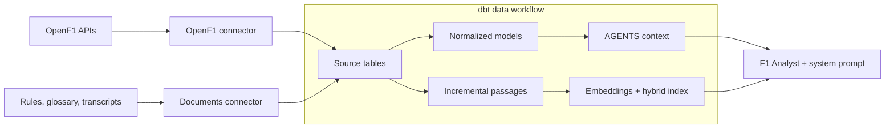

# F1: from API to agent

Two Fivetran connectors load OpenF1 race data and official documents into BigQuery. dbt builds normalized racing tables and one-to-one document tables with embeddings computed in dbt and hybrid indexes, and publishes the AGENTS context used by F1 Analyst in Gemini Enterprise.



| Component | Implementation |
|---|---|
| Ingestion | [OpenF1 connector](connectors/openf1/) and [documents connector](connectors/documents/); sources stay in `f1_openf1` and `f1_documents`. |
| Normalization | [dbt models](dbt/models/openf1/) in `f1`: people, teams, session entries, geography and facts at their original grains. |
| Document search | [Native document models](dbt/models/documents/) preserve each collection's schema one-to-one. The three passage models compute embeddings in their SELECT queries; [idempotent hooks](dbt/macros/document_search.sql) create hybrid indexes. Parent metadata stays separate and is joined for citations. |
| Agent context | The [publication macro](dbt/macros/publish_agents_schema.sql) builds `agents.root`, `dbt_tables`, `dbt_columns`, `dbt_joins`. |
| Experience | [Agent configuration and system prompt](scripts/configure_data_agent.py), published to [Gemini Enterprise](https://vertexaisearch.cloud.google.com/). |

OpenF1 covers 2025 and completed 2026 races; documents cover 2025 regulations and transcripts plus current glossary pages. Driver numbers identify session entries, not permanent people. Starting grids use Qualifying session keys and join Race sessions through the meeting. [ROOT guidance](dbt/macros/publish_agents_schema.sql) explains the other query limitations.

The document connector discovers transcripts from the FIA sitemap for the configured `transcript_years` (currently `2025`). Publication dates associate them with race weekends using the OpenF1 calendar. Regulations and glossary pages use fixed URLs in the [document manifest](connectors/documents/manifest.full.json). A transcript disappearing from the sitemap does not delete previously ingested text.

## Setup and operation

Use Python 3.12.8 and dbt Fusion 2.0.8. Create `.venv` with `python3.12 -m venv .venv` and install the pinned dependencies with `.venv/bin/python -m pip install -r requirements-dev.txt`. Copy [.env.example](.env.example) to `.env`, supply local settings, and restrict it with `chmod 600 .env`. Use Google application-default credentials; keep credentials outside the repository. See [operations](AGENTS.md) for connector deployment and one-time IAM/embedding setup.

Run the complete ingestion/build workflow on demand:

```sh
.venv/bin/python scripts/run_pipeline.py
```

Or build from already-synced sources with local Fusion:

```sh
(cd dbt && python3 ../scripts/with_config.py dbt build --profiles-dir . --threads 4 --no-manage-state)
```

Edit table and column descriptions in [OpenF1 schema.yml](dbt/models/openf1/schema.yml) and [document schema.yml](dbt/models/documents/schema.yml). Model `config.meta.agent_catalog` holds primary keys, row filters and joins, and opts models into the catalog. The [on-run-end macro](dbt/macros/publish_agents_schema.sql) publishes all four catalog tables after successful nonempty `run`/`build` commands, including focused selections. ROOT dataset overview and unstructured retrieval guidance live in the macro’s `root_content` block. Refresh all four catalog tables in `agents`:

```sh
(cd dbt && python3 ../scripts/with_config.py dbt run-operation publish_agents_schema --profiles-dir . --no-manage-state)
```

No seeds or external generator are needed. The hook publishes metadata for all catalog-marked models, not just the selected models. Tables update individually, so refresh the agent context only after the complete catalog publication succeeds. Embedding failures fail the model load; check index readiness separately because indexing is asynchronous:

```sh
.venv/bin/python scripts/configure_data_agent.py
.venv/bin/python scripts/inspect_document_search.py --query
```

Run connector behavior checks with `.venv/bin/python -m pytest`. Use `dbt parse` with the same profile flags for a parse-only check. There is no recurring schedule; local Fusion is the execution path. The Gemini Enterprise trial expires November 12, 2026.

## License

Project code is licensed under the [MIT License](LICENSE). Third-party content retains its owners' rights.
