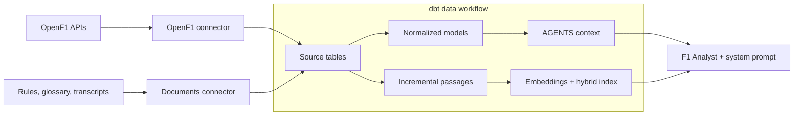

# F1: from API to agent

Two Fivetran connectors load OpenF1 race data and official documents into BigQuery. dbt builds normalized racing tables, adds managed embeddings and hybrid indexes directly to document source tables through an idempotent DDL hook, and publishes the AGENTS context used by F1 Analyst in Gemini Enterprise.



| Component | Implementation |
|---|---|
| Ingestion | [OpenF1 connector](connectors/openf1/) and [documents connector](connectors/documents/); sources stay in `f1_openf1` and `f1_documents`. |
| Normalization | [dbt models](dbt/models/openf1/) in `f1`: people, teams, session entries, geography and facts at their original grains. |
| Document search | [Idempotent hook](dbt/macros/document_search.sql) adds embeddings directly to the three source passage tables, with hybrid indexes for sources of at least 5,000 rows. Fivetran maintains the rows; the agent joins parents for metadata and citations. No dbt document models or copies. |
| Agent context | [Five inline SQL models](dbt/models/agents/) build `AGENTS.ROOT`, `TABLES`, `DIMENSIONS`, `MEASURES`, `JOINS`. |
| Experience | [Agent configuration and system prompt](scripts/configure_data_agent.py), published to [Gemini Enterprise](https://vertexaisearch.cloud.google.com/). |

OpenF1 covers 2025 and completed 2026 races; documents cover 2025 regulations and transcripts plus current glossary pages. Driver numbers identify session entries, not permanent people. Starting grids use Qualifying session keys and join Race sessions through the meeting. [ROOT guidance](dbt/models/agents/root.sql) explains the other query limitations.

The document connector discovers transcripts from the FIA sitemap for the configured `transcript_years` (currently `2025`). Publication dates associate them with race weekends using the OpenF1 calendar. Regulations and glossary pages use fixed URLs in the [document manifest](connectors/documents/manifest.full.json). A transcript disappearing from the sitemap does not delete previously ingested text.

## Setup and operation

Use Python 3.12.8 and dbt Fusion 2.0.8. Create `.venv` with `python3.12 -m venv .venv` and install the pinned dependencies with `.venv/bin/python -m pip install -r requirements-dev.txt`. Copy [.env.example](.env.example) to `.env`, supply local settings, and restrict it with `chmod 600 .env`. Use Google application-default credentials; keep credentials outside the repository. See [operations](AGENTS.md) for connector deployment and one-time IAM/embedding setup.

Run the complete ingestion/build workflow on demand:

```sh
.venv/bin/python scripts/run_pipeline.py
```

Or build from already-synced sources with local Fusion:

```sh
(cd dbt && python3 ../scripts/with_config.py dbt build --profiles-dir . --threads 4 --no-manage-state)
```

Edit the five [catalog SQL models](dbt/models/agents/) directly. ROOT selects one `user`/`user` row with a multiline Markdown string; the other models contain inline metadata rows and native primary-key arrays. Build them directly in AGENTS:

```sh
(cd dbt && python3 ../scripts/with_config.py dbt build --profiles-dir . --select tag:agents_schema --threads 4 --no-manage-state)
```

No seeds, generator, or publication hook are needed. Tables update individually, so refresh the agent context only after the complete catalog build succeeds. Check search readiness separately because embeddings and indexing are asynchronous:

```sh
.venv/bin/python scripts/configure_data_agent.py
.venv/bin/python scripts/inspect_document_search.py --query
```

Run connector behavior checks with `.venv/bin/python -m pytest`. Use `dbt parse` with the same profile flags for a parse-only check. There is no recurring schedule; local Fusion is the execution path. The Gemini Enterprise trial expires November 12, 2026.

## License

Project code is licensed under the [MIT License](LICENSE). Third-party content retains its owners' rights.
