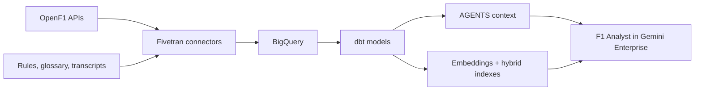

# F1: from API to agent

Explore Formula 1 race data and official documents with F1 Analyst in Gemini Enterprise. Fivetran loads the data into BigQuery, and dbt prepares it for analysis and search.

| Component | Implementation |
|---|---|
| Ingestion | [OpenF1 connector](connectors/openf1/) and [documents connector](connectors/documents/). |
| Racing data | [Normalized dbt models](models/openf1/). |
| Document search | [Document models](models/documents/) compute embeddings and create hybrid indexes using native BigQuery capabilities. |
| Agent context | [AGENTS schema](macros/publish_agents_schema.sql) describes tables, columns, joins and query guidance. |
| Analyst | [Agent configuration and system prompt](agents/configure_data_agent.py), published to [Gemini Enterprise](https://vertexaisearch.cloud.google.com/). |

## Setup and operation

1. Follow [operations](AGENTS.md) to configure credentials, IAM and connector dependencies, then deploy the connectors and complete their Fivetran syncs.
2. Configure dbt Cloud and GitHub using the [deployment guide](agents/README.md).
3. Push to `main` to build the dbt models, publish the AGENTS context, deploy the analyst and run evaluations.
